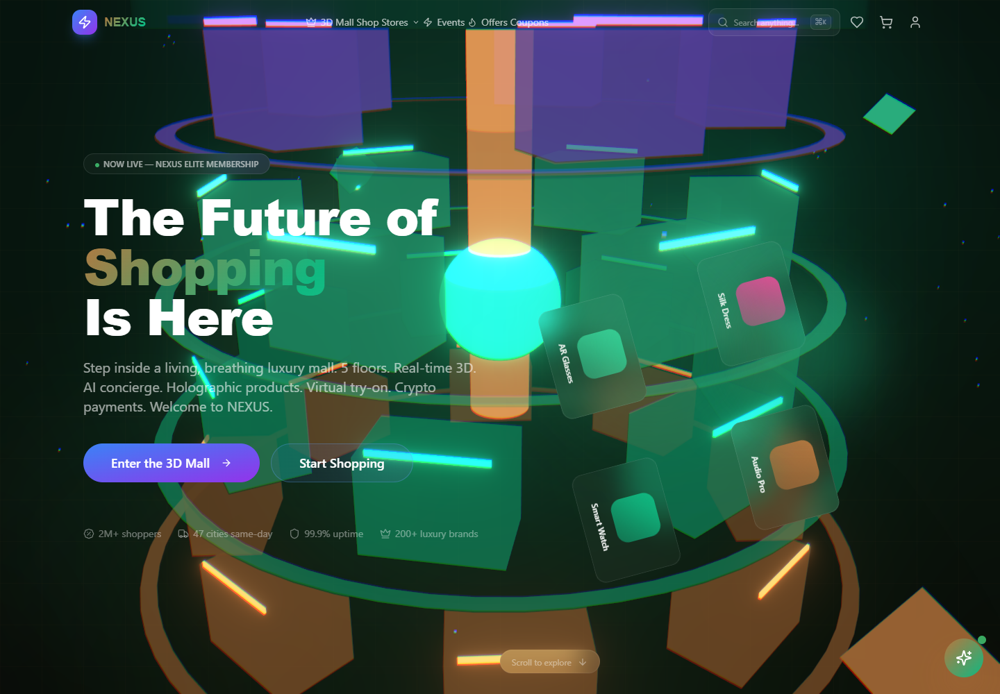
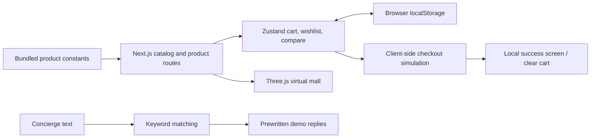

# NEXUS MALL

An immersive shopping UI prototype built with Next.js, React, Three.js, Zustand, and Radix primitives. The catalog, concierge responses, order confirmation, wallet, and account screens use demo/client-side data. This repository does not implement payment processing, merchant fulfillment, or a production identity service.



Captured from the local repository on 2026-11-10 at 1440×1000 in a fresh browser context with external requests blocked. Remote catalog photographs and fonts may be absent. The existing [demo recording](demo-assets/demo.gif) is retained as historical project media.

## Run

```sh
npm ci --ignore-scripts --legacy-peer-deps
npm run dev -- --hostname 127.0.0.1
```

Open the localhost address printed by Next. Node 24.18.0 was used in the local audit. The lockfile uses a prerelease React 19 version and has peer conflicts, which is why the reproducible install command retains legacy peer resolution. Do not enter real card details, credentials, or personal information into the demo checkout.

## Implemented data flow



Cart totals come from local product prices and quantities. Checkout advances local component state and clears the cart; it does not send an order to a merchant. Concierge replies are selected from text constants rather than generated by a model. Browser voice input depends on Web Speech API support.

## Validation and outstanding work

Use `npm run build` for a production bundle and `npx --no-install tsc --noEmit` for type checking. There is no configured automated test suite. `npm run lint` opens the Next ESLint setup prompt because an ESLint configuration is absent; it is not a completed lint check.

The existing [security dependency PR #1](https://github.com/ik123a/nexus-mall/pull/1) remains separate. Its recorded Vercel checks were successful when inspected on 2026-11-10, but that is historical evidence, not a fresh security or runtime guarantee. The audit did not upgrade dependencies or merge that PR. The current main lockfile retains Next 15.0.3 and an install-time vulnerability warning; review the existing patch before deployment.

This audit covers local cart/checkout flow, concierge implementation, build configuration, and documentation. It does not establish cross-device behavior, accessibility conformance, AR support, payment security, or production readiness. The local documentation commit can be rolled back with `git revert`.

The November repair removes the remote night-HDR dependency from the mall scene. Blocking external requests previously threw a loader error and unmounted the homepage; the scene now uses its existing local lights. No commerce or dependency version changes are included.
